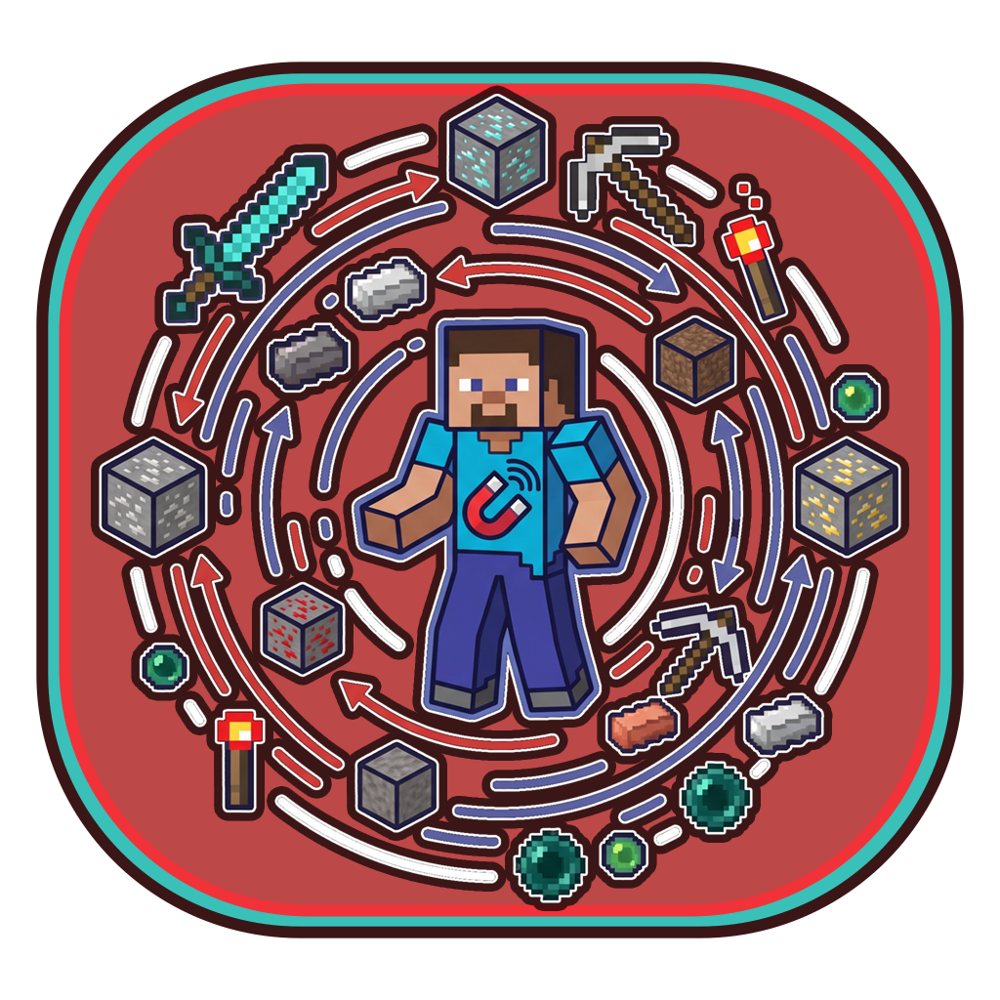
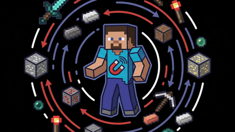

<p align="center">
  
</p>

<h1 align="center">MasterAttractor 🧲</h1>

<p align="center">
  <strong>A modern, highly customizable, and performance-friendly radius magnet mod for Minecraft Fabric.</strong>
</p>

<p align="center">
  <a href="https://github.com/houssemdub/masterattractor/releases"></a>
  <a href="https://fabricmc.net/"></a>
  <a href="https://fabricmc.net/"></a>
  <a href="https://adoptium.net/"></a>
  <a href="LICENSE"></a>
  <a href="https://github.com/houssemdub/masterattractor/actions"></a>
</p>

<p align="center">
  <a href="#-features">Features</a> •
  <a href="#-controls--usage">Controls</a> •
  <a href="#-smart-filtering">Item Filtering</a> •
  <a href="#-configuration">Configuration</a> •
  <a href="#-download--installation">Download</a> •
  <a href="#-preview">Preview</a>
</p>

---

## ✨ Features

- 🚀 **Versatile Attraction & Massive Range**:
  - **Massive Pull Radius**: Configurable from $1$ up to **$2048$ blocks** with optimized loaded-entity iteration to prevent server lag.
  - **Dropped Items** (configurable to respect or bypass initial pickup delay)
  - **Experience Orbs** (instant absorption with subtle audio-visual feedback)
  - **Projectiles** (incoming arrows, tridents, and throwables — ignores player's own shots)
  - **Living Mobs** (optional toggle to attract friendly or hostile creatures)
  - **Vehicles & Blocks** (optional attraction for Boats, Minecarts, and Falling Blocks like sand/gravel)
- 🕊️ **Butter-Smooth Flight & Organic Animations**:
  - **True No-Clip Flight**: Attracted items phase seamlessly through terrain, fences, blocks, and walls.
  - **Organic Inertia Blending**: Items accelerate and curve smoothly with blended momentum — zero teleportation or snapping.
  - **Pocket/Belt Targeting**: Flying items aim naturally at waist level ($0.75\text{m}$) into your pocket rather than right into your face.
  - **4 Flight Animation Modes**:
    - `ARC_HOP`: Parabolic jump launch with dynamic ceiling clearance clamping.
    - `SPIRAL`: Swirling vortex orbiting inwards into the pocket.
    - `MAGNETIC`: High-velocity tractor beam with exponential ease-in acceleration.
    - `FLOAT`: Gentle wave bobbing drift.
  - **Dynamic Ceiling Clamping**: Senses overhead ceilings and clamps launch hops to prevent hitting roofs.
- ✨ **Customizable Particle Trails & FX**:
  - **12+ Trail Effects**: Portal, Enchanted Hit, Flame, Soul Flame, Electric Spark, Glow, End Rod, Heart, Nautilus, Totem of Undying, Cherry Leaves, Bubbles, or None.
  - **Trail Density Controls**: Off, Low, Medium, High, Ultra.
  - **Arrival Sparkle Burst**: Satisfying visual pop when items safely land in your pocket.
- 🎯 **Smart Filtering & Anti-Swirl Overflow Protection**:
  - **Item Blacklist / Whitelist**: Filter out unwanted junk (dirt, cobblestone, rotten flesh) or pull only high-value materials.
  - **Inventory Overflow Protection**: Stops pulling items when your inventory is completely full, eliminating endless item orbiting and bouncing.
  - **Safe Vacuum Mode**: Option to directly insert items into player inventory upon arrival without ground bouncing or duplication glitches.
- ⚙️ **Deeply Customizable**:
  - Live radius adjustment ($1$ to $2048$ blocks).
  - Configurable pull strength / flight speed curves.
  - Tick interval throttling ($1$ tick = smoothest, higher = ultra-lightweight performance).
  - Sneak suppression: simply hold `Shift` to temporarily pause the magnet while sorting inventories or building.
  - Creative / invulnerable mode bypass toggle.
  - Multiplayer nearest-player attraction to eliminate tug-of-war.
- 🖥️ **In-Game Configuration GUI**:
  - Seamless integration with **Mod Menu** and **Cloth Config** across 7 organized categories.
- ⌨️ **Instant Keybind & Commands**:
  - Press **`V`** (configurable in Controls) for instant on/off toggling with action-bar confirmation.
  - `/attractor toggle`, `/attractor radius <1-2048>`, `/attractor animation <mode>`, `/attractor trail <type>`.
- 🌐 **Full Localization**:
  - Ready for multi-language translations (`en_us.json` baseline).

---

## 🎮 Controls & Usage

### Keybind
| Key | Action | Description |
|---|---|---|
| **`V`** *(default)* | Toggle Magnet | Instantly activates or deactivates MasterAttractor with an on-screen HUD notice. |

> Rebindable anytime in **Options ➔ Controls ➔ Key Binds ➔ MasterAttractor**.

### In-Game Commands
| Command | Permission | Description |
|---|---|---|
| `/attractor toggle` | All Players | Toggles personal attraction on/off. |
| `/attractor reload` | Operators (Level 2) | Reloads the configuration file from disk live without restarting. |
| `/attractor radius <1-2048>` | Operators (Level 2) | Sets the magnet search radius (supports up to $2048$ blocks!). |
| `/attractor strength <value>` | Operators (Level 2) | Sets the attraction acceleration force (e.g., `/attractor strength 2.0`). |
| `/attractor animation <mode>` | Operators (Level 2) | Sets flight animation (`ARC_HOP`, `SPIRAL`, `MAGNETIC`, `FLOAT`). |
| `/attractor trail <type>` | Operators (Level 2) | Sets particle trail (`PORTAL`, `FLAME`, `ELECTRIC_SPARK`, `HEART`, etc.). |

---

## 🎯 Smart Filtering

MasterAttractor includes a built-in item filter engine configurable directly via the Mod Menu GUI or `config/masterattractor.json`:

| Mode | Behavior |
|---|---|
| `NONE` | Pulls all valid dropped items within range (default). |
| `BLACKLIST` | Pulls everything **except** items in the configured filter list (e.g., cobblestone, dirt, rotten flesh). |
| `WHITELIST` | Pulls **only** items explicitly declared in the configured filter list (e.g., diamonds, ancient debris). |

---

## 🔧 Configuration

### 1. In-Game GUI (Mod Menu + Cloth Config)
1. Open the pause menu or title screen and select **Mods**.
2. Select **MasterAttractor** from the list.
3. Click the **Configure** button to open the settings interface.
4. Settings are divided into seven dedicated categories:
   - **General**: Master toggle, Radius (up to $2048$ blocks), Strength, Tick Interval.
   - **Flight & Animation**: Animation Mode (`ARC_HOP`, `SPIRAL`, `MAGNETIC`, `FLOAT`), Flight Speed, Launch Hop Multiplier, Ceiling Clamping, Target Pocket, Smooth Arrival, Instant Vacuum.
   - **Visual Trails & FX**: Particle Trail Effect (12 styles), Trail Density (Low, Medium, High, Ultra), Arrival Sparkle Burst.
   - **Audio & Sounds**: Pull Sound, Arrival Pop Chime, Volume, Pitch.
   - **Targets**: Items, XP, Projectiles, Mobs, Players, Boats, Minecarts, Falling Blocks.
   - **Item Filtering**: Filter Mode, Item List, Inventory Space Check, Safe Vacuum Mode.
   - **Behavior**: Pickup Delay, God Mode Bypass, Only Pull to Nearest Player.

### 2. Configuration File (`config/masterattractor.json`)
```json
{
  "enabled": true,
  "radius": 10.0,
  "strength": 1.25,
  "tickInterval": 1,
  "attractItems": true,
  "attractXpOrbs": true,
  "attractProjectiles": true,
  "attractMobs": false,
  "attractPlayers": false,
  "attractBoats": false,
  "attractMinecarts": false,
  "attractFallingBlocks": false,
  "filterMode": "NONE",
  "filteredItems": [
    "minecraft:cobblestone",
    "minecraft:dirt",
    "minecraft:andesite",
    "minecraft:diorite",
    "minecraft:granite",
    "minecraft:rotten_flesh"
  ],
  "checkInventorySpace": true,
  "vacuumMode": false,
  "ignorePlayersWithGodMode": true,
  "onlyPullToNearestPlayer": false,
  "respectPickupDelay": false,
  "playSoundOnPull": true,
  "spawnParticlesOnPull": true,
  "showRadiusOverlay": true,
  "overlayColor": 65280,
  "overlayOpacity": 0.3
}
```

---

## 📦 Requirements & Download

### Download
- Download the latest `.jar` build from the [**GitHub Releases**](https://github.com/houssemdub/masterattractor/releases).

### Requirements
- **Minecraft**: `1.21.11`
- **Fabric Loader**: `0.20.1` or higher
- **Fabric API**: `0.141.6+1.21.11` or higher
- **Java**: `21` or higher
- **Recommended Client Mods**:
  - [Mod Menu](https://modrinth.com/mod/modmenu)
  - [Cloth Config](https://modrinth.com/mod/cloth-config)

---

## 🛠️ Building from Source

To compile the mod JAR yourself:

```bash
git clone https://github.com/houssemdub/masterattractor.git
cd masterattractor
./gradlew build
```

The compiled and remapped JAR will be generated in `build/libs/`:
```
build/libs/masterattractor-1.0.0+1.21.11.jar
```

---

## 📄 License

This mod is available under the **MIT License**. Feel free to use it in modpacks or customize it to your needs!

---

## 📽️ Preview

<p align="center">
  
</p>
